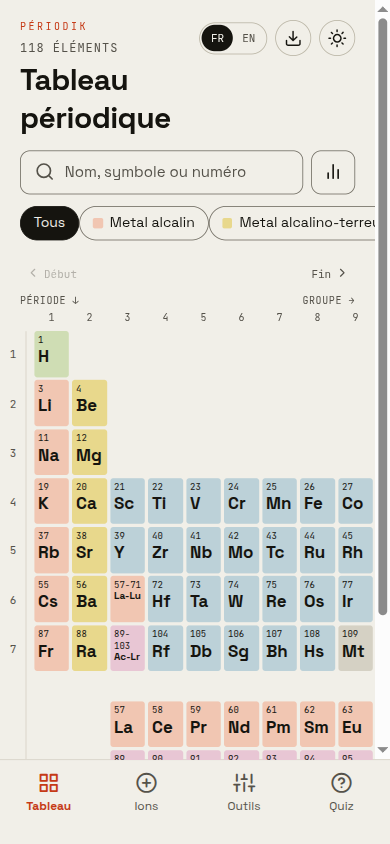
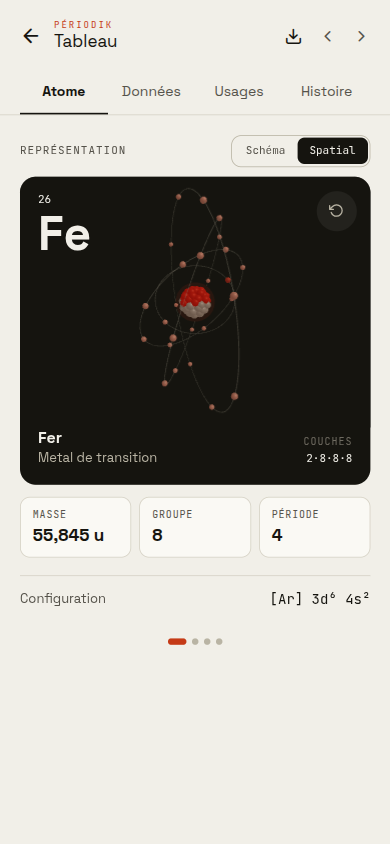
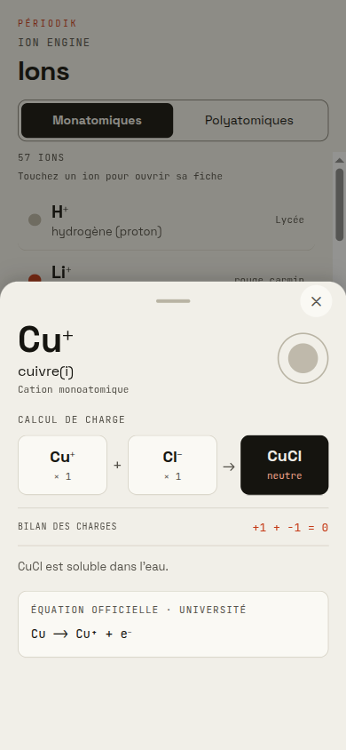
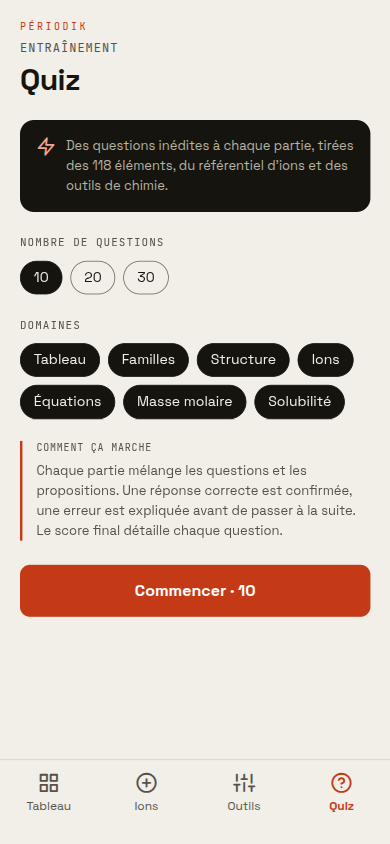
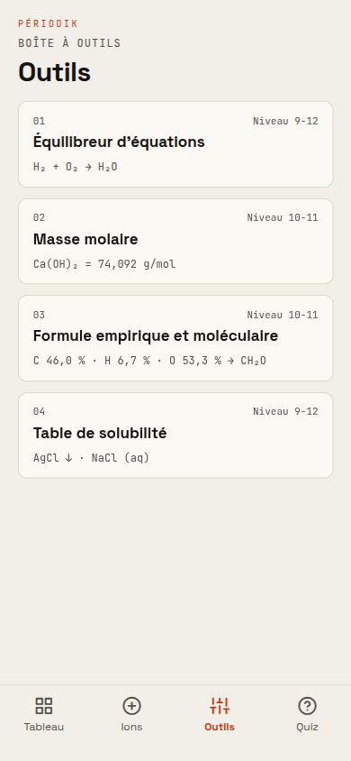
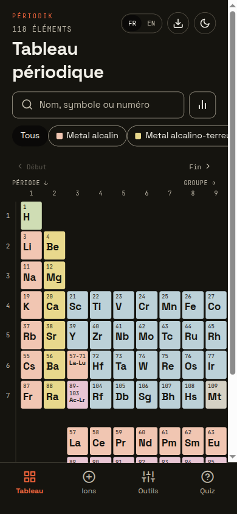

<div align="center">

# Périodik

## Build APK (Android uniquement)

Identifiant Android : `com.nabile.periodik`. Profil `apk` configuré dans `eas.json` (buildType `apk`, versionCode incrémenté automatiquement).

```bash
npx expo install --fix
npx expo-doctor
npx eas-cli@latest login
npx eas-cli@latest build -p android --profile apk
```

L'APK est téléchargeable depuis le dashboard Expo ou via le lien affiché en fin de build. Pour une nouvelle version, incrémenter `"version"` dans `app.json` (le versionCode est géré par EAS).

Taille : le bundle JS Hermes fait ~6,4 Mo. `expo-build-properties` limite les ABI Android à `armeabi-v7a` et `arm64-v8a`, désactive les décodeurs GIF/WebP et active R8 + shrinkResources en release. Ne pas comparer la taille installée-affichée par Android (libs natives décompressées) avec la taille du fichier APK.


**Le tableau périodique, l'atome en 3D et les outils de chimie dans la poche.**

Application mobile bilingue FR/EN pour réviser la chimie, du lycée à l'université.


*EN — Périodik is a bilingual chemistry study app: interactive periodic table, 3D atom viewer, ion reference, quiz and calculators.*

</div>

## Aperçu

| Tableau périodique | Atome en 3D | Moteur d'ions |
|:---:|:---:|:---:|
|  |  |  |

| Quiz | Équilibreur d'équations | Thème sombre |
|:---:|:---:|:---:|
|  |  |  |

## Uptodown

Le dossier `uptodown/` contient les éléments prêts à uploader : icône 512×512, 7 captures 1080×2400 et 4 featured images 1024×500 (FR et EN, clair et sombre). Les featured images sont les bannières promotionnelles, distinctes des captures, et sont demandées par langue. Publier les captures en anglais pour qu'elles soient visibles dans toutes les langues ; les textes FR/EN sont dans `store/`.

## Fonctionnalités

### Tableau périodique

- 118 éléments disposés selon leur famille, avec recherche instantanée et filtres par catégorie.
- Mini-carte de navigation, comparaison de 3 éléments sur 4 propriétés et export de la grille en image haute définition.

### Fiches élément

- Trois représentations complémentaires : schéma de Bohr 2D (couche de valence mise en évidence), vue spatiale 3D (orbites inclinées, électrons de valence colorés) et schéma de Lewis pour les groupes principaux.
- Onglets **Atome / Données / Usages / Histoire** : structure atomique, propriétés, usages, risques et contexte STSE.
- Cadrage automatique de la caméra du H à Og, bouton de réinitialisation de la vue et option « réduire les animations ».

### Ions

- Référentiel de 132 espèces monoatomiques et polyatomiques, classées par famille et par niveau (lycée / université).
- Fiche détaillée en bottom sheet avec charge, équation officielle de formation et niveau d'enseignement.

### Outils

- Équilibreur d'équations chimiques.
- Masse molaire, hydrates inclus.
- Formule empirique.
- Table de solubilité.

### Quiz

- Génération dynamique de 10, 20 ou 30 questions dans 7 domaines : tableau, familles, structure atomique, ions, équations, masse molaire et solubilité.
- Corrigé immédiat avec explication pour chaque réponse et score détaillé par domaine.

### Interface

- Bilingue **français / anglais** : chaînes d'interface, noms d'éléments et d'ions, explications et questions de quiz.
- Thème clair, sombre ou système, avec préférence persistée.
- Wordmark « PÉRIODIK », icône et splash dédiés, animation de marque au premier lancement.
- Export et partage d'images sur Android et iOS (indisponible sur le web dans Expo Go).

## Stack technique

| Couche | Choix |
|---|---|
| Runtime | Expo SDK 58 · React Native 0.88 · React 19 |
| Navigation | Expo Router (routes typées) |
| Langage | TypeScript 6 · ESLint 9 |
| 3D | Three.js · React Three Fiber · `expo-gl` |
| Animations | Reanimated 4 · worklets |
| État | Zustand 5 · AsyncStorage |
| Internationalisation | i18next · react-i18next |
| Export | `react-native-view-shot` · `expo-sharing` |
| Build & distribution | EAS Build / Update / Submit |

## Démarrage

Prérequis : Node.js et, selon la cible, l'application **Expo Go** ou un build de développement.

```bash
npm install
npx expo start
```

Ouvrir ensuite dans Expo Go (iOS/Android), un simulateur/émulateur ou le navigateur avec `npx expo start --web`. L'atome 3D repose sur `expo-gl`, inclus dans Expo Go en SDK 58 ; si vous ajoutez une bibliothèque avec du code natif, passez à un build de développement via `npx expo run:ios|android` ou `npx eas-cli@latest build --profile development`.

## Vérifications

```bash
npx tsc --noEmit      # typage
npm run lint          # ESLint
npx expo-doctor       # santé des dépendances
npx expo export --platform web
```

## Structure du projet

```text
src/
├── app/            # écrans Expo Router (tableau, element/[number], ions, outils, quiz, comparer)
├── components/     # Atom2D, AtomViewer, LewisDiagram, sheets, export, UI
├── data/           # éléments, ions, référentiel, banque de quiz, traductions
├── hooks/          # hooks partagés
├── lib/            # chimie, valence, i18n, export, polyfills
├── store/          # réglages persistés (locale, thème, animations)
├── theme/          # tokens, catégories, couches électroniques
└── types.ts
assets/             # icônes, adaptive icons, splash
store/              # captures 390 × 844 et textes des stores FR/EN
```

Le système visuel complet (palette, typographie, grille, contraintes d'accessibilité) est documenté dans [`DESIGN.md`](DESIGN.md).

## Accessibilité et internationalisation

- Cibles tactiles ≥ 40 px (via `hitSlop`), rôles, états et libellés d'accessibilité explicites (`accessibilityRole`, `accessibilityState`, `accessibilityLabel`).
- Schéma 2D et scène 3D exposés comme images accessibles avec résumé du nombre de couches et d'électrons.
- Bottom sheet des ions fermable par poignée, croix, tap à l'extérieur et bouton retour Android.
- Option « réduire les animations » : fige la rotation 3D et désactive l'intro.
- Largeur utile plafonnée à 560 px : la grille reste lisible sur tablette et sur le web.

## Attributions et licence

Distribué sous [licence MIT](LICENSE).

Données chimiques, traductions et visualiseur d'atome adaptés de [Zperiod](https://github.com/Zhilips/Zperiod), © 2026 Philip Zhao, sous licence MIT — détails dans [`NOTICE.md`](NOTICE.md) et [`LICENSE-UPSTREAM`](LICENSE-UPSTREAM).

Projet personnel et indépendant, non affilié à zperiod.app ni à son auteur.
